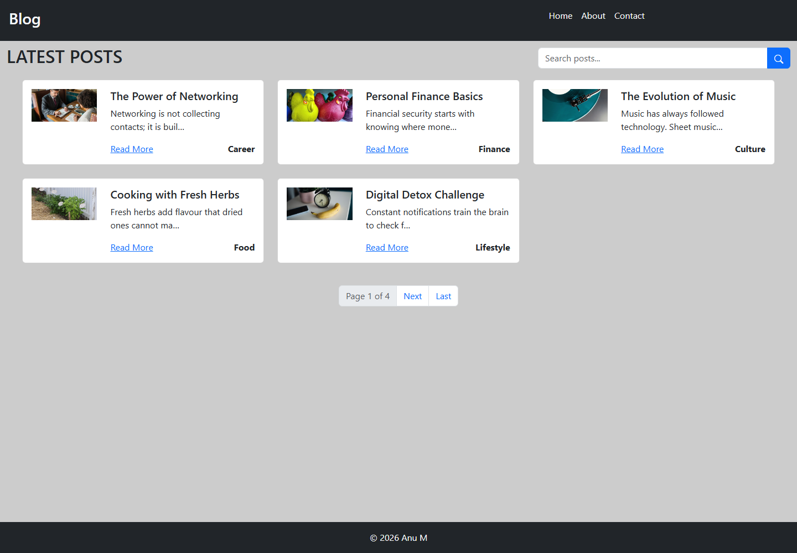

# Django Blog

[](https://github.com/anusanu162-sudo/django-blog/actions/workflows/ci.yml)

A server-rendered blog built with Django and MySQL. It has a public post list,
category pages, search, a contact form that stores messages in the database, and a
Django Admin area for managing content.



## Features

- `Post`, `Category`, `AboutUs` and `ContactMessage` models
- `Post` belongs to a `Category` through a `ForeignKey`
- Automatic URL slugs generated from the post title
- **MySQL** database (SQLite fallback for quick local setup)
- Django migrations for every schema change
- Django Admin for posts, categories, the About page and contact messages
- Post list with pagination (5 posts per page)
- Search by title, content or category
- Post detail page with related posts from the same category
- Contact form with validation; messages are saved and visible in the admin
- Custom 404 page
- Bootstrap 5 templates
- 7 automated tests and a GitHub Actions workflow

## Tech stack

| Layer | Technology |
|---|---|
| Language | Python 3.11+ |
| Framework | Django 5.2 |
| Database | MySQL 8.0 (SQLite fallback) |
| Front end | Django templates, HTML, CSS, Bootstrap 5 |
| Server | Django development server |
| Tests | Django TestCase |
| CI | GitHub Actions |

## Project structure

```text
myapp/
├── blog/
│   ├── management/commands/   # populate_categories, populate_posts
│   ├── migrations/            # 9 migrations
│   ├── static/                # CSS and post images
│   ├── templates/             # index, detail, about, contact, base
│   ├── admin.py
│   ├── forms.py
│   ├── models.py
│   ├── tests.py
│   ├── urls.py
│   └── views.py
├── myapp/
│   ├── settings.py
│   ├── settings_test.py       # in-memory SQLite for CI
│   ├── urls.py
│   └── views.py               # custom 404 handler
├── templates/404.html
├── .github/workflows/ci.yml
├── .env.example
├── manage.py
├── requirements.txt
└── README.md
```

## Run it locally

### 1. Clone and install

```bash
git clone https://github.com/anusanu162-sudo/django-blog.git
cd django-blog
python -m venv .venv
```

Windows:

```bash
.venv\Scripts\activate
```

macOS / Linux:

```bash
source .venv/bin/activate
```

```bash
pip install -r requirements.txt
```

### 2. Create your environment file

```bash
copy .env.example .env        # Windows
cp .env.example .env          # macOS / Linux
```

Open `.env` and set a long random `DJANGO_SECRET_KEY`.

### 3. Choose a database

**Option A — SQLite (fastest).** Leave `MYSQL_DATABASE` empty in `.env`. Django
will create `db.sqlite3` automatically.

**Option B — MySQL.** Create a database and fill in the MySQL values in `.env`:

```sql
CREATE DATABASE blog CHARACTER SET utf8mb4 COLLATE utf8mb4_unicode_ci;
```

```dotenv
MYSQL_DATABASE=blog
MYSQL_USER=root
MYSQL_PASSWORD=your-password
MYSQL_HOST=localhost
MYSQL_PORT=3306
```

### 4. Create the schema and sample content

```bash
python manage.py migrate
python manage.py populate_categories
python manage.py populate_posts
```

### 5. Create an admin user and run the server

```bash
python manage.py createsuperuser
python manage.py runserver
```

Open <http://127.0.0.1:8000/> for the blog and
<http://127.0.0.1:8000/admin/> for Django Admin.

## Tests

The test suite covers the post list, search, detail page, 404 page, contact form
validation and the About page.

```bash
python manage.py test
```

To run the same tests against SQLite, as CI does:

```bash
python manage.py test --settings=myapp.settings_test
```

## Notes and honest limitations

- The contact form **stores messages in the database**; it does not send email.
- Search uses Django's `icontains` lookup. It is simple and case-insensitive,
  not a full-text search engine.
- Images are either local files or external URLs. See
  [IMAGE_CREDITS.txt](IMAGE_CREDITS.txt) for the sources.
- This is a development project, not a production deployment. Set
  `DJANGO_DEBUG=False`, a real `DJANGO_SECRET_KEY` and a proper
  `DJANGO_ALLOWED_HOSTS` before deploying anywhere public.
- The project began as a Django course build and was extended with a working
  search, database-backed contact messages, tests and continuous integration.

## Licence

MIT. See [LICENSE](LICENSE).
